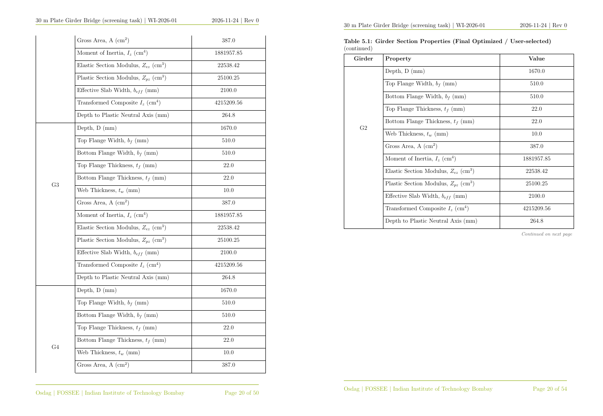
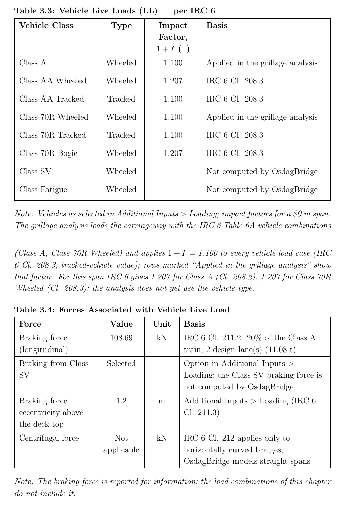
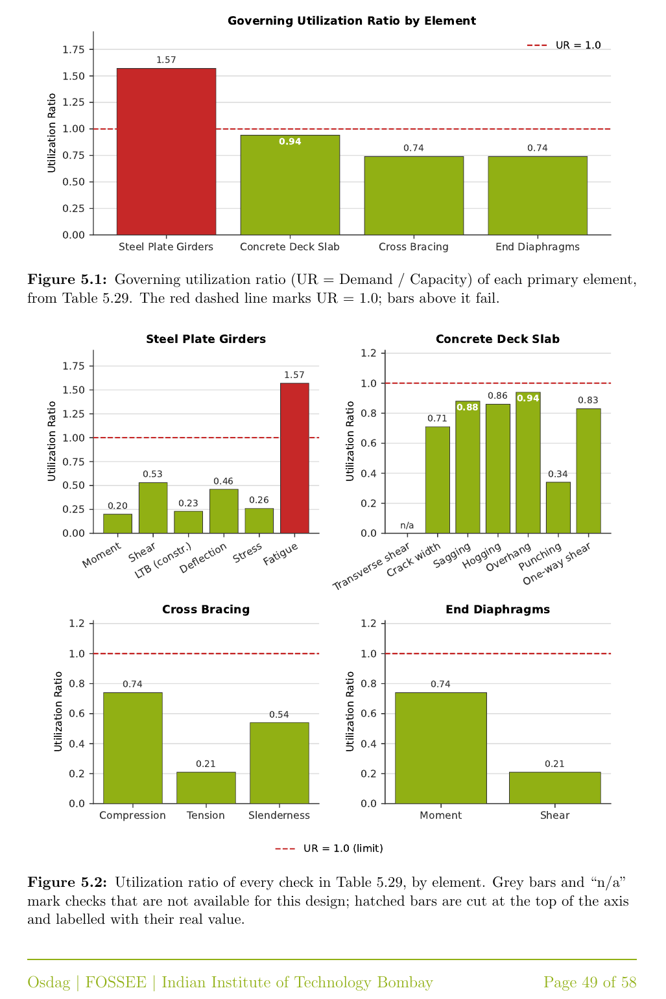
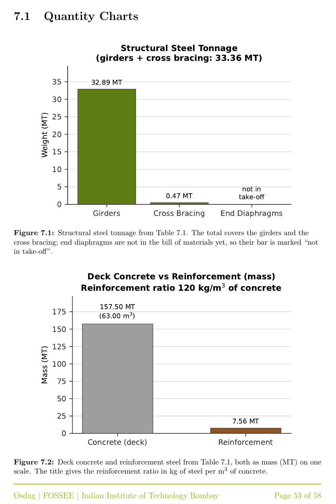

# Summary

All six items in the task were implemented in `osdagbridge/core/reports`, on top of
the `dev` branch of `Nidhikhare12/OsdagBridge` (commit `d74f56d`).

| # | Task item | Result |
|-|----------|--------------------------------------------|
| 1 | Repeated table headers across page breaks | All 51 longtables now have `\endfirsthead` / `\endhead` / `\endfoot`; the header (or the caption, for header-less tables) is printed again on every page with "(continued)", and the page ends with "Continued on next page" |
| 2 | Footer overlap and vertical spacing | Multirow groups (one girder = several rows) can no longer be split by a page break, so labels such as "G4" no longer print on the footer; page geometry is explicit (head height, footskip, bottom margin) |
| 3 | Live load tables | One merged table became three: vehicle live loads (one row per vehicle selected in Additional Inputs > Loading), forces associated with the vehicle live load (braking, centrifugal), and footway live load, each with a unit column |
| 4 | Utilization ratio charts | Section 5.5 now has a governing-UR chart per element and a per-check UR chart for Steel Plate Girders, Concrete Deck Slab, Cross Bracing and End Diaphragms, with a red dashed UR = 1.0 line |
| 5 | Material quantity charts | Chapter 7 now has a structural steel tonnage chart (girders, cross bracing, end diaphragms) and a concrete volume vs reinforcement weight chart |
| 6 | Central style system | New `styles.py` holds page geometry, colours, fonts, table padding, spacing, header/footer theme and chart look; chapter files use the macros it generates instead of hard-coded values |

Measured on the same input file (30 m span, 7.5 m carriageway, Pune), generated
headlessly with `make_report.py` before and after the change:

| Check | Before | After |
|------------------------------|--------|-------|
| LaTeX errors in the compile log | 139 | 0 |
| Tables with a repeated header | 2 | 51 |
| Multirow labels printed in the footer area | 1 ("G4", page 28) | 0 |
| Pages | 51 | 55 |

The extra pages come from the new charts (two pages) and from row groups that now
move to the next page as a whole instead of being split.

# How the report was tested

* `screening_task/make_report.py` loads an `.osi` file, runs the full design
  (`PlateGirderBridge.set_input` + `design`) and calls
  `generate_design_report`, exactly as the GUI does. `Report_Before.pdf` was made
  this way from the unmodified `dev` code and `Report_After.pdf` the same way from
  this branch. `Report_After_GUI.pdf` was made from this branch through the GUI
  (File > Load Input, Design, File > Create Design Report), as shown in the video;
  it has the same layout, but some values from the design run differ between
  GUI and headless runs of the same file: the railing load, and the cross
  bracing and end diaphragm checks, which only the GUI run computes (the headless
  reports show "---" in those rows). The chart screenshots below come from the
  GUI report for that reason. The 3D CAD
  views are placeholders in both PDFs: the GUI here ran on a virtual display with
  software OpenGL and did not export them, and that export is outside the report
  code changed in this task.
* Three scripts check the PDF itself rather than the LaTeX source:
  `check_footer.py` (a girder label printed in the footer band),
  `check_tables2.py` (a "(continued)" head printed on the same page as the
  table's first head) and `check_orphans.py` (a caption and header left alone at
  the bottom of a page).
* `tests/unit/test_report_tables_and_charts.py` (9 tests) covers the table
  post-processing, the style block and the charts, and
  `tests/unit/test_report_fixes.py` (13 tests) covers the fixes in section 7 and
  the impact factors. The existing unit tests still
  pass.

# 1. Repeated table headers

**Problem.** 47 of the 49 longtables in the old report defined their header row once.
When a table continued on the next page, the rows appeared without column headings.
Their captions were also written as `\caption{...}` without the `\\` that longtable
requires, which is where 138 of the 139 LaTeX errors came from.

**Change.** `latex_tables.repeat_longtable_headers()` rewrites each longtable's head
into the standard longtable form:

```latex
\caption{Title}\\  <header rows>  \endfirsthead
\caption[]{Title (continued)}\\  <header rows>  \endhead
\multicolumn{n}{r}{\continuednote}\\  \endfoot
\endlastfoot
```

* The header is taken from the table itself (everything from the first `\hline`
  to the `\hline` that closes the first row), so multi-row headers with `\cline`
  and `\makecell` work.
* A table is only changed if its first row really is a header (it contains
  `\textbf`). Header-less key/value tables keep their first data row in place and
  get a terminated caption plus a "(continued)" caption on later pages.
* Tables that already had `\endhead` (Tables 2.8 and 4.1) are left alone, and the
  function is idempotent.
* `report_generator.generate_report` runs it on every chapter's LaTeX through
  `finalize_tables()`, so new tables written by chapter authors are covered
  without extra work.

The original code comment in `generate_report` warned against post-processing the
whole document because it could misorder captions and headings. The function
works per table, parses captions with brace matching instead of regular
expressions, and is covered by tests for that reason.



# 2. Footer overlap and page layout

**Problem.** On page 28 of the old report the label "G4" was printed over the
footer. Table 5.7 has one `\multirow` group of six rows per girder; when the page
broke inside the G4 group, `\multirow` still centred the label over all six rows,
which put it below the page's last row.

**What did not work, and why.** Rows inside a group are separated by `\cline`. A
first attempt marked those row ends as `\\*` (longtable's "no page break here"),
but the page still broke inside groups. A test document showed why: `\cline` is a
row of its own and ends with `\noalign{\vskip-\arrayrulewidth}`, and TeX may break
at that skip. `\\*` only protects the gap before the rule.

**Change.**

* `latex_tables.keep_row_groups_together()` changes the row ends inside a group to
  `\\*` and the `\cline` after them to `\groupcline`.
* `\groupcline` is defined in `styles.py`: it is colortbl's `\@cline` with a
  `\nobreak` placed before the closing negative skip, so there is no break point
  after the rule. A group now always moves to the next page as a whole; breaks
  still happen between groups.
* The page geometry is set explicitly from `styles.PAGE` (`headheight`,
  `headsep`, `footskip`, a 1.2 in bottom margin) instead of a bare `margin=1in`,
  so the footer rule, the "* Software default value" note and the page number have
  reserved space.

**A second layout bug found while testing.** The old preamble ran `\needspace` before
every longtable. Once the tables had a real head, this made longtable break the page
at the very start of some tables: an empty "Continued on next page" foot was left on
one page and the continued head was printed above the first head on the next (seen
on several tables during testing, for example Tables 3.7, 5.6 and 5.8). Removing `\needspace` only for
longtables fixed all of them; longtable already keeps its first head with the first
row. Ordinary `table` environments keep `\needspace`.


# 3. Live load tables (Chapter 3)

**Problem.** Vehicle live load and footway load were rows of one key/value table.
Vehicles were a comma-separated list, impact factors were two values in one cell,
the braking load always printed "N/A", and the footway row was empty. A value
computed for the footway load (`fp_str`) was never used.

**Change.** `chap3._live_load_tables()` builds three tables:

* **Vehicle Live Loads (LL) per IRC 6:** one row per vehicle selected in
  Additional Inputs > Loading, with type (wheeled or tracked), impact factor
  $1 + I$ for the span, and the clause (IRC 6 Cl. 208.2 for Class A, Cl. 208.3 for
  Class 70R and Class AA). Special and fatigue vehicles are listed but marked "Not
  computed in the report", because the report never had a value for them.
* **Forces Associated with Vehicle Live Load:** braking force in kN with the
  number of design lanes and the clause (IRC 6 Cl. 211.2), and centrifugal force
  as not applicable (IRC 6 Cl. 212 applies only to horizontally curved bridges).
* **Footway Live Load:** number of footpaths and the footway pressure in kN/m²,
  "Not applied" when the bridge has no footpath, otherwise IRC 6 Cl. 206.1 or the
  user's value.

**Bugs fixed on the way.**

* `IRC6_2017.cl_211_2_braking_force()` raised `NameError` for one or two lanes
  (`braking_force_2` was never set), which is why the report always said "N/A".
  Both parts now start at zero.
* That helper returns Newtons (the code module's base unit) although its
  docstring says tonnes; the old report multiplied the value by 9.81 as if it were
  tonnes. The new table divides by `kN` and `t` from `keyfile`, giving 108.69 kN
  (11.08 t) for two lanes: 20% of the Class A train.
* When the lane table is empty, the design lanes now come from IRC 6 Table 6 using
  the carriageway width, through the existing `IRC6_2017.table_6A`.
* `IRC6_2017.cl_208_3_impact_factor()` chose between the wheeled and tracked
  rules by testing `KEY_VEHICLE[1]`, a constant non-empty string, so it always
  returned the tracked value. For a 30 m steel span the report printed 1.100 for
  every Class 70R and Class AA vehicle, but IRC 6 Cl. 208.3 gives wheeled vehicles
  25% up to 23 m and $9/(13.5 + L)$ beyond, so 1.207. The helper now takes
  `tracked=True/False`, applies the clause for steel bridges (including the linear
  drop from 25% at 5 m to 10% at 9 m for tracked vehicles), and the table passes
  each vehicle's type. Called without the argument it behaves as before, so the
  analysis results do not change (see Known limits).



# 4. Utilization ratio charts (Section 5.5)

`chap5` already built Table 5.22 (Overall Design Check Summary) row by row. The rows
are now described once as (label, element, short name, cells), and the same list
produces both the table and the chart data, so the chart always shows exactly what
the table shows. The UR number is read back from the table's UR cell.

`report_charts.py` draws two figures with matplotlib (Agg backend, saved as vector
PDF):

* **Governing UR by element:** the highest UR of each of the four elements.
* **UR of every check:** a 2 x 2 grid, one panel per element, one bar per check.

Bars are green up to UR = 1.0 and red above it; a red dashed line marks UR = 1.0;
checks without a value are grey and labelled "n/a", and an element without any
check says so. In the test design the girders' fatigue check has UR = 1.57, which
the chart shows in red, matching the "Fail (Fatigue ...)" status in the Executive
Summary.

{ width=60% }

# 5. Material quantity charts (Chapter 7)

`chap7` now ends with a "Quantity Charts" section drawn from the same quantities as
Table 7.1 (`boq_generator.calculate_material_quantities`):

* **Structural steel tonnage:** girders, cross bracing (top, bottom and diagonal
  members added up) and end diaphragms, with the total in the title. The bill of
  materials does not include end diaphragms yet, so that bar is shown as "not in
  take-off" instead of a made-up zero.
* **Deck concrete vs reinforcement:** concrete volume (m³, left axis) next to
  reinforcement weight (MT, right axis), with the steel ratio in kg/m³ in the
  title (120 kg/m³ in the test design).

The Chapter 7 table opened a `\begingroup` that was never closed, so its tighter
column spacing leaked into the rest of the report; it now ends with `\endgroup`.

{ width=60% }

# 6. Central style system (`styles.py`)

**Problem.** Fonts, colours, padding, rule widths, margins and spacing were spread
across the preamble and the chapter files: `\\[6pt]` row padding appeared 225
times, `\textcolor{red}` 14 times, `\setlength{\tabcolsep}{...}` with four
different values in six files, and `\vspace{...}` with ten different values in the
chapter files.

**Structure of `styles.py`.**

| Name | Holds |
|--------|------------------------------------------|
| `PAGE` | paper, font size, margins, head height, head separation, footskip, line spacing |
| `COLORS` | Osdag green, status colours, muted text, design-log colours |
| `FONTS` | footer note size, "continued" note size, dense table font |
| `TABLE` | column padding presets, array stretch, row padding, rule width, longtable skips, "(continued)" wording |
| `SPACING` | every vertical gap by role (`tablegap`, `smallgap`, `sectiongap`, ...) |
| `HEADER_FOOTER` | rule colour and thickness, footer text, page number format |
| `FIGURES`, `CHART` | figure widths; matplotlib fonts, colours, DPI and sizes |
| `GROUP_CLINE` | the `\groupcline` definition used for item 2 |

Functions generate LaTeX from these values: `geometry_options()`,
`latex_style_block()` (colours, table settings and the macros below) and
`header_footer_block()` (the three fancyhdr page styles). `status_cell()` and
`ur_cell()` give chapter code one way to format PASS/FAIL and UR values.

| Macro | Replaces |
|------------------|----------------------------------|
| `\rowpad` | the `6pt` in every `\\[6pt]` |
| `\tablegap`, `\smallgap`, `\mediumgap`, ... | every `\vspace{...}` in the chapter files (the figure helper and the title page keep their own spacing) |
| `\statusfail{..}`, `\statuspass{..}` | `\textcolor{red}{..}`, `\textcolor{black}{..}` |
| `\compactcols`, `\narrowcols`, `\tightcols`, `\widecols`, `\tallrows` | `\setlength{\tabcolsep}{..}`, `\renewcommand{\arraystretch}{..}` |
| `\densetablefont` | `\footnotesize` in the Chapter 4 table |
| `\continuednote` | "Continued on next page" text |

The replacement in the chapter files was done with a script that edits only Python
string tokens and treats raw and normal string literals separately (in a normal
literal `\t` of `\tablegap` would otherwise become a tab character). Every changed
module compiles with warnings treated as errors.

To restyle the report, change a value in `styles.py`; no chapter file needs editing.

# 7. Fixes from a second review

A second pass over the new code found these problems, all fixed and tested:

* **Charts and the desktop app.** `report_charts` called `matplotlib.use("Agg")`
  and used `pyplot` with global `rcParams`. The desktop app draws its own plots
  with the QtAgg backend (`mpl_plot_widget.py`) and builds the report in a
  `QThread`, so generating a report switched the app's backend, could close its
  open figures, and changed fonts and spines for every later plot. The charts now
  use `matplotlib.figure.Figure` with an Agg canvas and set their style on each
  axes; a test checks that the backend and `rcParams` are unchanged afterwards.
* **Chart paths.** Charts were included by absolute path. With a relative build
  folder pdflatex could not find them (four "File not found" errors), and on
  Windows a temporary folder such as `C:/Users/JOHNDO~1/...` breaks
  `\includegraphics` because `~` is an active character in LaTeX. Charts are now
  referenced as `images/<name>.pdf`, relative to the folder pdflatex runs in.
* **Non-finite values.** A UR or quantity of `inf` or `nan` (capacity of zero)
  made matplotlib raise on the axis limits and stopped the whole report. Such
  values are now drawn as "n/a".
* **Long project names.** The running header puts "project | job" on the left
  and "date | revision" on the right of one line, so a long project name ran
  into the date. It is now cut at 50 characters (job number at 20) with an
  ellipsis; the title page still shows the full name. Both limits are in
  `styles.HEADER_FOOTER`.

# Files changed

| File | Change |
|------------------|------------------------------------------|
| `reports/styles.py` | **new**: central style system |
| `reports/latex_tables.py` | **new**: repeated headers, row-group protection |
| `reports/report_charts.py` | **new**: UR and quantity charts, drawn without pyplot or global matplotlib state |
| `reports/report_generator.py` | preamble built from `styles.py`; chapters passed through `finalize_tables()`; chart directory passed to Chapters 5 and 7; long header text shortened |
| `reports/chap3.py` | three live-load tables; old merged table and unused strings removed |
| `reports/chap5.py` | Table 5.22 rows described once; UR charts in Section 5.5 |
| `reports/chap7.py` | quantity charts; missing `\endgroup` |
| `reports/chap2.py`, `chap4.py`, `chap6.py`, `chap8.py`, `executive_summary.py` | hard-coded formatting replaced by style macros |
| `reports/report_utils.py` | `≤` and `≥` written as math so pdflatex accepts them |
| `utils/codes/irc6_2017.py` | braking force `NameError` for one or two lanes; Cl. 208.3 impact factor for wheeled and tracked vehicles |
| `tests/unit/test_report_tables_and_charts.py` | **new**: 9 tests |
| `tests/unit/test_report_fixes.py` | **new**: 13 tests |

# Known limits

* The 3D CAD figures come from the GUI's OCC viewer. They are placeholders in
  both PDFs here, because the GUI ran on a virtual display with software OpenGL
  and exported no views. This task did not change the CAD export or the code that
  embeds the exported views.
* End diaphragms are not in the bill of materials yet, so their tonnage bar is
  shown as missing.
* `analyser.py` (line 1803) and `deckdesign.py` (line 503) still call
  `cl_208_3_impact_factor(span)` without the vehicle type, so the analysis keeps
  using the tracked value (1.10 at 30 m) for wheeled Class 70R and AA loading.
  Changing that changes design results, so it is left for the maintainers to
  decide; passing `tracked=False` for wheeled vehicles is the fix.
* The footway row shows the IRC 6 Cl. 206.1 intensity. For main girders IRC 6
  Cl. 206.3 reduces it with span and footway width; the code module has no
  helper for that yet.
* Keeping each girder's rows on one page leaves white space at the bottom of
  some pages (Table 5.1 is the largest case); with the two chart pages this is
  why the report grew by four pages.
* Two small `Overfull \vbox` warnings (5.4 pt) from the nine-column Table 4.1 were
  already present before the change and are unchanged.
