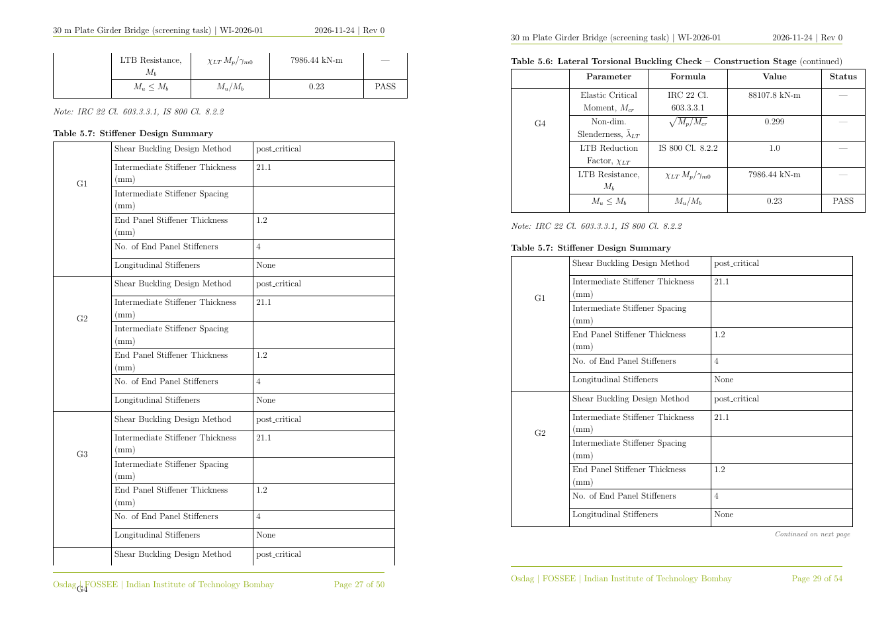
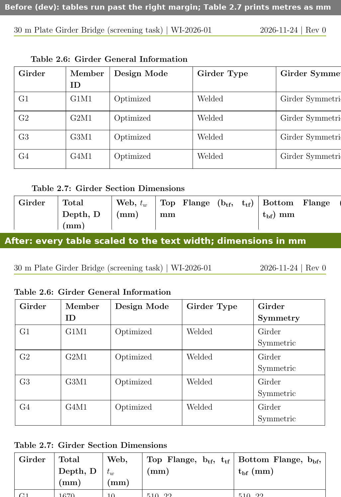

# Summary

All six items in the task were implemented in `osdagbridge/core/reports`, on top of
the `dev` branch of `Nidhikhare12/OsdagBridge` (commit `d74f56d`).

| # | Task item | Result |
|-|----------|--------------------------------------------|
| 1 | Repeated table headers across page breaks | All 51 longtables have a first head, a continued head with the column header and a "(continued)" caption, and a "Continued on next page" foot |
| 2 | Footer overlap and vertical spacing | No text below the text block or past the right margin on any page; every table is scaled to the text width; multirow group labels are top-aligned; page geometry is explicit |
| 3 | Live load tables | Three tables: vehicle live loads (one row per vehicle selected in Additional Inputs > Loading, with the impact factor the analysis applied), the forces that come with them (braking, its eccentricity, centrifugal) and the footway load, each with its unit |
| 4 | Utilization ratio charts | Section 5.5 has two numbered figures: the governing UR per element, and the UR of every check for Steel Plate Girders, Concrete Deck Slab, Cross Bracing and End Diaphragms, with a red dashed UR = 1.0 line |
| 5 | Material quantity charts | Chapter 7 has two numbered figures: structural steel tonnage (girders, cross bracing, end diaphragms) and deck concrete against reinforcement, both as mass on one scale |
| 6 | Central style system | `styles.py` holds page geometry, colours, fonts, captions, chapter headings, the table of contents, the title page, table padding and widths, spacing, header and footer, figure sizes and the chart look; chapter files use the macros and values it provides |

Measured on the same input file (30 m span, 7.5 m carriageway, Pune), generated
headlessly with `make_report.py` from `dev` and from this branch
(`logs/latex_errors.txt`, `logs/pdf_checks.txt`):

| Check | Before | After |
|-------------------------------------------------|--------|-------|
| LaTeX errors in the compile log | 139 | 0 |
| Overfull `\hbox` warnings | 59 | 0 |
| Overfull `\vbox` warnings | 2 | 0 |
| Longtables that repeat their column header | 1 of 49 | 51 of 51 |
| Pages that start with table rows but no head | 9 | 0 |
| Words printed right of the text block | 267 | 0 |
| Body text below the text block | 1 ("G4", page 28) | 0 |
| Pages | 51 | 58 |

The extra pages come from the two chart pages, from row groups that move to the
next page as a whole, and from narrower columns: tables that used to run into the
margin now wrap inside the text width.

# How the report was tested

* `screening_task/make_report.py` loads an `.osi` file and runs the steps the
  desktop app runs after File > Load Input, Design and File > Create Design
  Report: `solve_extend_basic_input_dict`, `PlateGirderBridge.set_input` and
  `design`, then `generate_design_report` with the fields the report dialog
  fills. `Report_Before.pdf` was made this way from the unmodified `dev` code
  and `Report_After.pdf` the same way from this branch.
  `Report_After_GUI.pdf` is the same branch through the GUI, as in the video.
  The 3D CAD views are placeholders in all PDFs: they are exported from the GUI's
  OCC viewer, which this task did not change.
* Four scripts check the PDF itself rather than the LaTeX source
  (poppler-utils only): `check_footer.py` (any body text below the text block or
  right of it), `check_heads.py` (a page that starts with table rows but no table
  head), `check_tables2.py` (a "(continued)" head on the same page as the first
  head) and `check_orphans.py` (a caption and header left alone at the bottom of
  a page). `count_heads.py` counts the heads and feet in the generated `.tex`.
* 52 unit tests pass: the 3 existing ones, `test_report_tables_and_charts.py`
  (9), `test_report_fixes.py` (13) and `test_report_layout_and_data.py` (27). One
  of them compiles a report preamble with a row group taller than a page and
  checks with `pdftotext` that the group label is printed once, in the group's
  first row, and that no text falls below the text block.

# 1. Repeated table headers

**Problem.** 47 of the 49 longtables in the old report defined their header row
once, and Table 2.8 had an empty continued head, so on later pages the rows
appeared without column headings. Their captions were also written as
`\caption{...}` without the `\\` that longtable requires, which is where 138 of
the 139 LaTeX errors came from.

**Change.** `latex_tables.repeat_longtable_headers()` gives every longtable the
standard longtable head and foot:

```latex
\caption{Title}\\  <header rows>  \endfirsthead
\caption[]{Title~(continued)}\\  <header rows>  \endhead
\multicolumn{n}{r}{\continuednote}\\  \endfoot
\endlastfoot
```

* The header is taken from the table itself (from the first `\hline` to the
  `\hline` that closes the first row), so multi-row headers with `\cline`,
  `\multicolumn`, `\multirow` and `\makecell` work.
* The first row is only treated as a header when every one of its cells is bold
  (after unwrapping `\multicolumn`, `\multirow` and `\makecell`). A key/value
  table whose first data row starts with a bold cell keeps that row as data.
  Header-less tables get a terminated caption and a "(continued)" caption; their
  top rule moves into the head, so longtable measures the first row group when it
  decides whether the table fits on the current page.
* A table that already has `\endfirsthead` and `\endhead` is completed rather
  than skipped: an empty continued head (Table 2.8) is treated as missing, and a
  full one without a continued caption or foot (Table 4.1) gets both.
* A long title is shortened in the continued caption so that "(continued)" never
  wraps onto a line of its own: a trailing parenthetical is dropped first, then
  whole words. Table 5.1 continues as "Girder Section Properties (continued)".
* Every table is transformed on its own inside `try`/`except`: a table that cannot
  be parsed is left as it was and logged, and the rest of the report is built.
  Braces are matched with escapes handled, so a caption ending in `\\` works.
* `report_generator.generate_report` runs the transforms on every chapter through
  `finalize_tables()`, so new tables written by chapter authors are covered without
  extra work. All transforms are idempotent.

{ width=90% }

# 2. Footer overlap, table widths and page layout

**Footer overlap.** On page 28 of the old report the label "G4" was printed over
the footer: Table 5.7 has one `\multirow` group per girder, the page broke inside
the G4 group, and `\multirow` centred the label over all six rows, which put it
below the last row of the page.

* `latex_tables.keep_row_groups_together()` makes every group label of a table
  body top-aligned (`\multirow[t]`), so the label is printed in the group's first
  row and cannot end up below the page's last row.
* Groups of up to 16 rows (`styles.TABLE["keep_together_rows"]`) are also kept on
  one page: their row ends become `\\*` and the `\cline` after them becomes
  `\groupcline`, colortbl's `\@cline` with a `\nobreak` before its closing
  negative skip (a `\cline` is a row of its own, and TeX may otherwise break
  after it). A taller group may break; its label stays at the top.
* The page geometry is set explicitly from `styles.PAGE` (`headheight` 18 pt,
  which fancyhdr needs for the 12 pt header, `headsep`, `footskip`, a 1.2 in
  bottom margin), so the footer rule, the "* Software default value" note and the
  page number have reserved space.

**Table widths.** About twenty tables were wider than the text block (up to
59 pt), including Chapters 2 to 5. `latex_tables.fit_tables_to_width()` fixes
this once for the whole report. For every longtable and tabular whose columns
have absolute widths (`p`, `m`, `b`, `C`, `L`, `R`), it adds `2\tabcolsep` per
column and the vertical rules to the column widths; if the total is wider than
the text width computed from `styles.PAGE` (452.97 pt for A4 with 1 in side
margins), it scales the widths down proportionally. It tracks `\begingroup`,
`\endgroup` and environments, so the padding is the default or the
`\compactcols`, `\narrowcols` or `\tightcols` preset active where the table
starts. The widths written in the chapter files are therefore proportions. A few
proportions were changed where a header word was wider than its scaled column
("Member", "Controlling", "Longitudinal"), and the three widest Chapter 5 tables
(seven and eight columns) now use `\compactcols`. The last overfull lines (long clause references
in Chapter 8) are handled by `\emergencystretch` from `styles.PAGE`. The result is
zero overfull `\hbox` warnings.

**Other layout fixes.** The Chapter 4 figure placeholders end with `\par`; two of
them used to share a line and ran off the page. The title page is page 1 and
the next page is page 2, so "Page N of M" matches the PDF and hyperref no longer
reports a duplicate `page.1`. The old preamble's `\needspace` before every
longtable made longtable break the page at the start of some tables, so it is
only used before ordinary `table` environments.

{ width=90% }

{ width=90% }

# 3. Load and geometry tables

**Problem.** Vehicle and footway live loads were rows of one key/value table:
vehicles as a comma-separated list, two impact factors in one cell, a braking load
that always printed "N/A" and an empty footway row.

**Change.** `chap3._live_load_tables()` builds three tables:

* **Vehicle Live Loads (LL) per IRC 6** (Table 3.3): one row per vehicle selected
  in Additional Inputs > Loading, with the tab's labels and in its order (Class A,
  Class AA Wheeled, Class AA Tracked, Class 70R Wheeled, Class 70R Tracked,
  Class 70R Bogie, Class SV, Class Fatigue), plus user-defined vehicles. A
  checkbox counts as selected under the same rule as
  `resolve_live_load_definitions` (`True`, "true", "yes", "1", "checked"), so
  "False" or "No" in an older `.osi` file is not selected. The impact factor is
  the one the design used: the grillage analysis places the IRC 6 Table 6A
  vehicle combinations (Class A and Class 70R Wheeled) and applies
  `1 + IRC6_2017.cl_208_3_impact_factor(L)` to every vehicle load case, 1.100 for
  30 m. Those rows show 1.100, and a note under the table gives the IRC 6 value
  where it differs (1.207 for Class A under Cl. 208.2 and for wheeled Class 70R
  under Cl. 208.3). Vehicles that the analysis does not place show their IRC 6
  Cl. 208.3 value for wheeled or tracked vehicles. The report therefore never
  states two factors for one vehicle without an explanation, and Table 5.16 (deck
  slab, governing vehicle Class 70R Wheeled, 1.100) agrees with Table 3.3. The
  unit is in the header (1 + I is dimensionless). A gross-load column was not
  added: the code module defines the Class A, Class 70R Wheeled, Class SV and
  fatigue vehicles, but not Class AA or the Class 70R bogie, and the report should
  not invent loads.
* **Forces Associated with Vehicle Live Load** (Table 3.4): the braking force in
  kN with the vehicle train it is based on (20 % of the Class A train, plus 5 %
  of a Class 70R Wheeled train per lane beyond two), the number of design lanes
  and the clause (IRC 6 Cl. 211.2); "Not applied" when no vehicle is selected;
  the Class SV braking option of the Loading tab; the braking eccentricity above
  the deck top from the Loading tab (Cl. 211.3); and the centrifugal force as not
  applicable (Cl. 212 applies only to curved bridges). A note says that the load
  combinations do not include braking.
* **Footway Live Load** (Table 3.5): number of footpaths and the footway pressure
  in kN/m², "Not applied" without a footpath.

**Bugs fixed on the way.**

* `IRC6_2017.cl_211_2_braking_force()` raised `NameError` for one or two lanes
  (`braking_force_2` was never set), and for more than two lanes it overwrote the
  extra-lane part on every lane instead of adding it. Both parts now start at zero
  and the extra-lane part accumulates (`+=`); a test checks 1, 2, 3, 4 and 6 lanes.
  This is the only change to the design code module.
* That helper returns Newtons (the module's base unit); the table divides by
  `kN` and `t` from `keyfile`: 108.69 kN (11.08 t) for two lanes.
* `IRC6_2017.cl_208_3_impact_factor()` always returned the tracked value because
  it tested `KEY_VEHICLE[1]`, a non-empty constant. It now takes
  `tracked=True/False` for the IRC 6 values in the table; called without the
  argument it behaves as before, so the analysis results do not change.
* Table 2.7 printed metres with an "mm" suffix ("Total Depth 1.67 mm"):
  `design()` converts the girder dimensions to metres before the report is built.
  The table now prints 1670, 10, "510, 22" under its "(mm)" headers.
* Blank rows: Table 2.4 shows the number of design lanes (IRC 6 Table 6 from the
  carriageway width), Table 3.6 shows Vz and Pz, rows that the design does not
  compute say "Not computed", and Table 4.2 gives the largest reaction at each
  support with its load case (from the same data as Table 4.1).

{ width=90% }

# 4. Utilization ratio charts (Section 5.5)

`chap5` builds the Overall Design Check Summary (Table 5.29) row by row. The rows
are described once as (label, element, short name, cells), and the same list
produces both the table and the chart data; the UR is read back from the table's
UR cell, so the chart always shows what the table shows. The table carries
`\label{tab:overall-summary}`, and both captions cite it with `\ref`.

`report_charts.py` draws two figures with matplotlib (Agg canvas, vector PDF):

* **Figure 5.1, governing UR by element:** the highest UR of each of the four
  elements.
* **Figure 5.2, UR of every check:** a 2 x 2 grid, one panel per element.

Bars are green up to UR = 1.0 and red above it, with a red dashed line at 1.0.
The value labels never sit on that line: a label that would touch it goes inside
its bar (white) or just above the line. The UR axis stops at 2.0: a larger UR,
or an infinite one (zero capacity), is drawn as a hatched red bar up to the cap
and labelled with its real value ("∞" for zero capacity). Checks without a value
are grey "n/a". With the headless run fixed (section 8), all four panels are
populated in `Report_After.pdf`.

The report generator emits raw LaTeX strings (the codebase has no PyLaTeX
objects), so the charts are embedded with `\includegraphics` inside `figure`
environments through the same helper as the other figures, with `\caption` and
`\label` for the numbering, instead of a PyLaTeX `Figure` object.

{ width=90% }

# 5. Material quantity charts (Chapter 7)

Chapter 7 ends with a "Quantity Charts" section drawn from the same quantities as
Table 7.1 (`boq_generator.calculate_material_quantities`), which now has a real
caption:

* **Figure 7.1, structural steel tonnage:** girders, cross bracing (top, bottom
  and diagonal members added up) and end diaphragms. The bill of materials does not
  include end diaphragms yet, so that bar says "not in take-off", and the title
  names what the total covers ("girders + cross bracing: 33.36 MT").
* **Figure 7.2, deck concrete against reinforcement:** both as mass on one axis
  (157.50 MT of concrete, 63.00 m³, and 7.56 MT of reinforcement), with the
  reinforcement ratio in the title (120 kg/m³). The concrete mass is the weight
  of Table 7.1; without it, the volume times the IRC 6 Cl. 203 unit weight. The
  earlier version drew the two quantities on two axes scaled to their own values,
  so the bars always had the same height.

A chart that fails (a matplotlib or disk error) is left out and logged; the report
is still produced. The same holds for the Section 5.5 charts.

{ width=90% }

# 6. Central style system (`styles.py`)

**Problem.** Fonts, colours, padding, rule widths, margins and spacing were spread
across the preamble and the chapter files: `\\[6pt]` row padding appeared 225
times, `\textcolor{red}` 14 times, `\setlength{\tabcolsep}{...}` with four
different values in six files, `\vspace{...}` with ten different values, and the
caption setup, title page, table of contents and chapter heading format were
written inline.

**Structure of `styles.py`.**

| Name | Holds |
|--------|------------------------------------------|
| `PAGE`, `PAPER_SIZES` | paper, font size, margins, head height, head separation, footskip, line spacing, emergency stretch; `text_width_pt()` |
| `COLORS` | Osdag green, status colours, muted text, design-log colours |
| `FONTS`, `CAPTION` | caption label font, figure caption font, caption skips, footer note, dense tables, stacked formulas |
| `HEADINGS`, `TOC` | chapter heading format and spacing, unnumbered titles, table of contents entries |
| `TITLE_PAGE` | logo sizes, title sizes, gaps, information table widths |
| `TABLE` | column padding presets, row padding, rules, longtable skips and alignment, "(continued)" wording and caption length, group keep-together limit, label alignment |
| `SPACING` | every vertical gap by role (`tablegap`, `smallgap`, `sectiongap`, ...) |
| `HEADER_FOOTER` | rule colour and thickness, footer text, page number format, header and footer gaps |
| `FIGURES`, `CHART` | figure widths and gaps; matplotlib fonts, colours, sizes, UR axis cap |
| `GROUP_CLINE` | the `\groupcline` definition |

Functions generate LaTeX from these values: `geometry_options()`,
`caption_setup()`, `chapter_heading_block()`, `toc_block()`,
`latex_style_block()` (colours, table settings, macros) and
`header_footer_block()`. `status_cell()`, `status_text_cell()`, `warn_cell()` and
`ur_cell()` format every PASS / FAIL / WARN and UR cell of the chapters.

| Macro | Replaces |
|------------------|----------------------------------|
| `\rowpad` | the `6pt` (and three `8pt`) in every `\\[..]` |
| `\tablegap`, `\smallgap`, ... | every `\vspace{...}` in the chapter files |
| `\statusfail{..}`, `\statuspass{..}` | `\textcolor{red}{..}`, plain "PASS" / "FAIL" |
| `\compactcols`, `\narrowcols`, `\tightcols`, `\tallrows` | `\setlength{\tabcolsep}{..}`, `\renewcommand{\arraystretch}{..}`; always inside a group |
| `\flushlefttables` | `\setlength\LTleft{0pt}`, `\setlength\LTright{\fill}` |
| `\formulafont`, `\formulagap` | `\footnotesize` and `\\[3pt]` in the stacked formula cell |
| `\densetablefont`, `\continuednote` | `\footnotesize` in Table 4.1, "Continued on next page" |

To restyle the report, change a value in `styles.py`. The chapter files still
define the structure of their tables: which columns there are, their relative
widths and which padding preset a wide table uses. The widths are proportions that
the central fit-to-width step scales; no chapter file sets a font size, colour,
gap or caption style any more.

# 7. Fixes from a second review of the first version

* **Charts and the desktop app.** The charts use `matplotlib.figure.Figure` with
  an Agg canvas instead of `pyplot` and `matplotlib.use("Agg")`, so building a
  report inside the app's `QThread` no longer switches the app's QtAgg backend or
  changes `rcParams`; a test checks both.
* **Figure paths.** Charts and the exported analysis images are referenced as
  `images/<name>`, relative to the folder pdflatex runs in, instead of by absolute
  temporary path. With a relative build folder the absolute form produced "File
  not found" errors; relative paths also avoid depending on how a platform spells
  its temporary folder (on Windows a short name may contain "~"; TeX Live accepted
  such a path in a test, MiKTeX was not tested).
* **Non-finite values.** A UR or quantity of `inf` or `nan` no longer stops the
  report (see section 4 for how `inf` is drawn).
* **Long project names** are cut at 50 characters in the running header
  (`styles.HEADER_FOOTER`); the title page shows the full name.

# 8. Fixes after the review

A review of the submitted version found the following; all are fixed and tested.

* Table 2.8 continued on page 8 without a head (an empty `\endhead` in `chap2.py`
  that the post-processor skipped), and Table 4.1 had no continued caption or foot.
  Both are handled now (section 1); `check_heads.py` checks every page.
* The UR chart caption cited "Table 5.22" (a variable name); the summary table is
  Table 5.29. It is now a `\label`/`\ref`. The four charts are numbered figures.
* Tables ran up to 59 pt past the right margin (234 overfull `\hbox` warnings).
  The central fit-to-width step brings this to zero (section 2), and `headheight`
  is 18 pt (fancyhdr warned on every page at 15 pt).
* Table 2.7 printed metres as mm; Table 3.3 stated an impact factor that the
  analysis did not use; the braking rows ignored the Loading tab and under-counted
  lanes beyond two (section 3).
* The concrete and reinforcement bars always had the same height; UR labels could
  sit on the 1.0 line; one extreme UR flattened the other bars; an infinite UR
  showed as "no checks" (sections 4 and 5).
* The headless `Report_After.pdf` had no cross-bracing or end-diaphragm results.
  Cause: stage 7 of `design()` sends the member designs to a process pool
  (`connect.design_pool`, forkserver start method), whose workers re-import the
  main module; `make_report.py` had no `if __name__ == "__main__"` guard, so each
  worker ran the script again and died, and every member design was skipped
  ("A process in the process pool was terminated abruptly"). The script now runs
  in `main()` behind the guard, and it leaves the report's project location empty
  as the report dialog does, so the location and weather rows come from the `.osi`
  file. No design code was changed for this.
* Groups taller than a page could still leave their label on the footer; labels
  are top-aligned now (section 2), and `check_footer.py` flags any body text below
  the text block instead of only `G` labels within 25 pt of the footer.
* Hard-coded formatting left in the chapter files moved into `styles.py`
  (section 6); dead entries (`\widecols`, the unused `\title` block and `\todo`
  macro, a chart helper alias) were removed.

# Files changed

| File | Change |
|------------------|------------------------------------------|
| `reports/styles.py` | **new**: central style system |
| `reports/latex_tables.py` | **new**: repeated heads, group labels and keep-together, fit to text width |
| `reports/report_charts.py` | **new**: UR and quantity charts, drawn without pyplot or global matplotlib state |
| `reports/report_generator.py` | preamble, title page and contents from `styles.py`; every chapter through `finalize_tables()`; relative figure paths; chart folder for Chapters 5 and 7 |
| `reports/chap3.py` | three live-load tables following the Loading tab; analysis impact factor; braking rows; computed or "Not computed" rows |
| `reports/chap5.py` | Table 5.29 rows described once, labelled; numbered UR charts; status and UR cells from `styles.py` |
| `reports/chap7.py` | numbered quantity charts; Table 7.1 caption; missing `\endgroup` |
| `reports/chap2.py`, `chap4.py` | Table 2.7 in mm, lanes, Table 2.8 head, Table 4.2 reactions, placeholders, column proportions |
| `reports/chap6.py`, `chap8.py`, `executive_summary.py`, `report_utils.py` | figure sizes, gaps and headings from `styles.py`; numbered figure option |
| `utils/codes/irc6_2017.py` | braking force (`NameError`, extra lanes); Cl. 208.3 by vehicle type |
| `tests/unit/test_report_layout_and_data.py` | **new**: 27 tests |
| `tests/unit/test_report_tables_and_charts.py`, `test_report_fixes.py` | 22 tests |

# Known limits

* The 3D CAD figures come from the GUI's OCC viewer and are placeholders in the
  PDFs here. This task did not change the CAD export.
* End diaphragms are not in the bill of materials yet, so their tonnage bar says
  "not in take-off".
* The grillage analysis places the IRC 6 Table 6A combinations (Class A and
  Class 70R Wheeled) whatever is selected in the Loading tab, and applies the
  Cl. 208.3 tracked-vehicle impact factor to all of them (`analyser.py`
  line 1803; the deck design does the same for Class 70R, `deckdesign.py`
  line 503). The report states this in the note under Table 3.3; changing it
  changes design results, so it is left for the maintainers.
* Braking is reported but not part of the load combinations, and the Class SV
  braking force is not computed by the code module.
* The footway row shows the IRC 6 Cl. 206.1 intensity; IRC 6 Cl. 206.3 reduces it
  for main girders, and the code module has no helper for that yet.
* Keeping each girder's rows on one page leaves white space at the bottom of some
  pages (Table 5.1, 13 rows per girder, is the largest case).
* A GUI run can still differ from a headless run where the GUI's input widgets
  rewrite the loaded values (for example the railing load).
